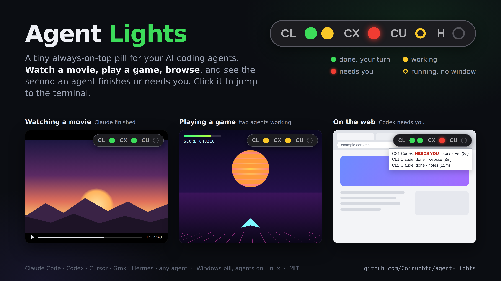

# Agent Lights

**A tiny always-on-top pill that shows what your AI coding agents are doing.** Watch a movie, play a game or
browse the web. One glance tells you when an agent finishes or needs you. Click the pill and your terminal comes up.



One dot per agent session running in a terminal tab. Two Claude tabs = two Claude dots. Works with:

| Agent | 🟡 working | 🟢 done | 🔴 needs you |
|---|---|---|---|
| [Claude Code](https://docs.claude.com/en/docs/claude-code) | ✓ | ✓ (also after Esc) | permission prompts and questions |
| [Codex CLI](https://github.com/openai/codex) | ✓ | ✓ (also after Esc) | approval prompts |
| [Cursor CLI](https://cursor.com/cli) | ✓ | ✓ (also after Esc) | – (Cursor has no hook for its approval prompt yet) |
| Grok CLI | ✓ | ✓ | permission prompts |
| [Hermes Agent](https://github.com/NousResearch/hermes-agent) | ✓ | ✓ | questions |
| anything else | one command from its hooks: [Any other agent](#any-other-agent) | | |

Each agent's dots get a short tag: its first letter, or two letters when two of your agents share one. Claude
alone is **C**; Claude, Codex and Cursor together are **CL**, **CX** and **CU**. Hover the pill to see which is which.

| Dot | Meaning |
|---|---|
| 🟢 green | finished, your turn (also after you press Esc) |
| 🟡 yellow | working |
| 🔴 red, blinking | needs you: a permission prompt or a question, or the last turn errored |
| ◯ grey ring | no session of that agent |
| ◯ hollow colored ring | still running in tmux, but no window shows it (the tab closed or ssh dropped) |
| red pill edge | can't reach the agent machine |

- **Click** = show your terminal (a normal Windows Terminal window with tabs) on top, **without taking the
  keyboard**: your game or movie keeps focus, so its sound keeps playing. Click into the terminal to type. Click the
  pill again to tuck it away, and the keyboard goes back to your game.
- **Hover** = which dot is which: `C1 Claude: NEEDS YOU - api-server (8s)`.
- **Drag** = move it. The pill itself never takes focus from your game or video.
- **Right-click** = a row per dot:
  - **Open**: attach that session in a new tab. A session in a plain tab can be moved: it's stopped there and resumed here.
  - **Close**: end that agent, after a "Yes, end it" right there in the menu.
  - **Close all with no window**: clear the hollow rings.
  - **Reopen a closed session**: the last 10 from the past day. It runs the agent's own resume command
    (`claude --resume`, `codex resume`, `agent --resume`, ...) inside tmux.

Background agents, cron jobs, headless runs (`claude -p`, `codex exec`) and the Codex or Cursor desktop apps never
get a dot. Only sessions in a terminal you're actually sitting in front of do.

## What you need

- **Where the agents run:** Linux with Python 3. A server you ssh into, a desktop, or a VM all work.
  `tmux` is optional; it powers Open, Reopen and the hollow rings.
- **Where you watch:** Windows 10 or 11 with Windows Terminal. It's built into Windows 11; on Windows 10 get it from the Store.
  The pill is plain Windows PowerShell 5.1, so there's nothing to install.
- The two can be the same PC (agents in WSL). That should work but is untested so far: use `-Server localhost`.

## Install

**1. On the Linux machine** (where you run `claude` / `grok` / `hermes`):

```bash
git clone https://github.com/Coinupbtc/agent-lights.git ~/agent-lights
bash ~/agent-lights/host/install.sh
```

It hooks into whichever of Claude Code, Codex, Cursor CLI, Grok CLI and Hermes you have. Every config it edits is
backed up first, and your other hooks are left alone. Installed another agent later? Run it again. It also starts a
small status server (`agent-lights.service`, port 8777), and ends by printing one line to paste on Windows, with
your address and token filled in.

**Codex:** the next time you start `codex`, it asks you to review the new hooks. Pick **Trust all and continue**.
Codex runs no hook until you do.

**2. On Windows**, download this repo (Code → Download ZIP, then unzip), open PowerShell in that folder, and paste the
line from step 1. It looks like this:

```powershell
powershell -ExecutionPolicy Bypass -File .\windows\install.ps1 -Server 192.168.1.20 -Token <token> -SshHost you@192.168.1.20
```

The pill appears top-right and starts with Windows. For games, use **borderless / windowed fullscreen**: nothing
can draw over exclusive fullscreen.

**Sound while you type:** many games go quiet when another window has the keyboard. The pill and a terminal you
only look at leave your game's sound alone, but typing in the terminal takes the keyboard. To keep the sound then
too, turn on the game's own background-sound option (World of Warcraft: Settings → Audio → **Sound in Background**,
or type `/console Sound_EnableSoundWhenGameIsInBG 1` in chat).

### Optional: keep agents alive when ssh drops

Put this in `~/.bashrc` on the Linux machine. Over ssh, `claude` then runs inside its own tmux session, so a
closed tab or a dropped connection doesn't kill it. The pill shows it as a hollow ring, and **Open** brings it back.

```bash
claude() {
  case " $* " in *" -p "*|*" --print "*|*" --version "*|*" -v "*) command claude "$@"; return ;; esac
  if [ -n "${SSH_TTY:-}" ] && [ -z "${TMUX:-}" ] && [ -t 1 ] && command -v tmux >/dev/null; then
    tmux new-session -s "claude-$(date +%H%M%S)" "$(type -P claude)" "$@"
  else
    command claude "$@"
  fi
}
```

Copy it with `codex`, `agent`, `grok` or `hermes` in place of `claude` for those.

### Your own tags

`~/.config/agent-lights/config.json` (on the Linux machine) lists the agents that get a slot on the pill, in order.
Add `tags` to pick your own (one to three characters):

```json
{
  "agents": ["claude", "codex", "cursor"],
  "tags": {"codex": "X", "cursor": "U"}
}
```

The server rereads it on its own; the pill updates within a couple of seconds.

### Any other agent

Anything that can run a command when it starts working, finishes or waits for you can drive a dot:

```bash
python3 ~/agent-lights/host/status_hook.py --agent aider --state working     # also: done, needs_you, error, ended
```

- Add `--session <id>` if the agent has session ids; without it you get one dot per running process.
- If the agent's hooks send a JSON event on stdin with `hook_event_name` (the Claude Code format, which Factory Droid,
  Qwen Code and others also use), leave out `--state`: `status_hook.py --agent droid` reads the event itself.
- Put the agent in the `agents` list above to give it a slot. For Reopen, add its resume command:
  `"resume": {"aider": "aider --restore-chat-history"}` (`{id}` and `{cwd}` are filled in).

## Security

- The status server needs a **token** for everything except `/health`. The token is 64 random hex characters in
  `~/.config/agent-lights/token`, created on first start with mode 600. It also only answers loopback, Tailscale
  and private-network addresses.
- **Close** only ends live terminal sessions that the hooks recorded, matched by process ID and start time.
  It never touches gateways or background runs. Each close is logged: `journalctl --user -u agent-lights`.
- Traffic is plain HTTP. On a network you don't trust, use [Tailscale](https://tailscale.com) (encrypted) or bind
  the server to localhost and use an ssh tunnel: `AGENT_LIGHTS_BIND=127.0.0.1 bash host/install.sh`, then
  `ssh -L 8777:localhost:8777 you@host` and `-Server localhost`.
- The pill only reads its own settings file. It changes no SSH keys, SSH config or Windows Terminal settings.

## How it works

- **Claude Code / Codex / Cursor / Grok:** command hooks run `host/status_hook.py`, which writes one small JSON
  file per session to `~/.local/state/agent-lights/sessions/`. It records the agent's process ID and start time,
  and whether it sits in a real terminal tab. **Hermes:** the `hermes/agent-lights` plugin writes the same files.
- **Codex** runs hooks in one background server shared by all your Codex windows, so the hook finds the window
  each conversation belongs to: by its id for `codex resume <id>`, otherwise the newest window in that folder.
- **Esc:** Claude Code fires no hook when you interrupt it (older Codex neither), so the server reads the end of the
  transcript to turn a stuck yellow or red dot green.
- A hook never blocks its agent: it prints nothing and always exits 0, even if this folder is deleted.
- **`host/status_server.py`** (Python standard library only) drops a session the moment its process exits. It works
  out whether the session is in tmux (attached or not), a plain ssh tab or a desktop terminal, and serves `/status`.
- **`windows/AgentLights.ps1`** is a WinForms pill compiled at launch by Windows PowerShell. It polls every 2 s, and
  tries each address you gave in order (e.g. Tailscale first, then LAN). Open writes a small `.cmd` that runs
  `ssh -t <host> ~/.local/bin/agent-lights-open <session>` in a new tab of its own Windows Terminal window.
- Nothing hooks into games or video players. It's an ordinary top-most desktop window.

## Uninstall

- Linux: `bash ~/agent-lights/host/uninstall.sh`
- Windows: right-click the pill → Exit. Then delete `%LOCALAPPDATA%\AgentLights`, `%APPDATA%\AgentLights` and
  `Agent Lights` from the Startup folder (`shell:startup`).

## Not yet

- A macOS menu-bar pill. The server side would work as is.
- Agents running natively on Windows or macOS. The hooks read Linux `/proc`.
- Built-in hooks for Gemini CLI, GitHub Copilot CLI and opencode (all have hook or plugin systems; use
  [Any other agent](#any-other-agent) until then).

## License

MIT
